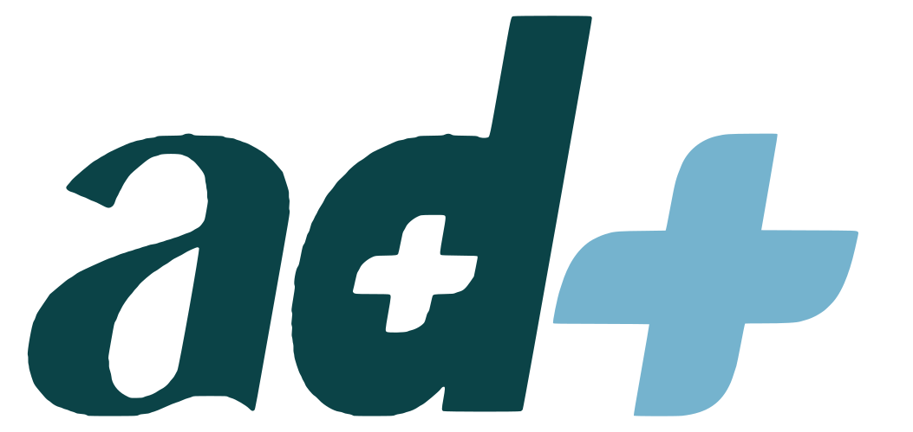

# Ad+ Saúde · modelo base

Base para montar o sistema de **agenda e prontuário** de uma **nova clínica**. Repositório **privado**, sem dados de nenhuma clínica.

Nasceu do sistema da Clínica Adintus (em uso real) e reúne:

| Pasta | Conteúdo |
|---|---|
| `site/` | App completo em um único `index.html` + página do paciente `p.html` |
| `site-eventos/` | Página pública de inscrição em eventos (opcional) |
| `supabase/functions/` | Funções: link do paciente, e-mail da agenda, API para assistente, inscrição em eventos, suporte |
| `supabase/sql/` | SQL na ordem de ativação (ver `docs/CONFIGURAR-NOVA-CLINICA.md`) |
| `docs/` | Passo a passo, lista do que trocar, funções do sistema |
| `brand/` | Logos Ad+ |

## Como começar uma nova clínica
1. No GitHub, clique em **Use this template** (ou copie esta pasta) e crie um repositório **privado** novo, ex.: `clinica-NOME`.
2. Siga **`docs/CONFIGURAR-NOVA-CLINICA.md`** do início ao fim (Supabase, Cloudflare, Resend, dados da clínica).
3. Nunca trabalhe direto neste repositório com dados reais: ele é só o modelo. Melhorias que valem para todas as clínicas voltam para cá.

Funcionalidades: ver `docs/FUNCOES.md`.
